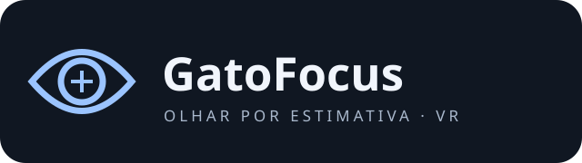
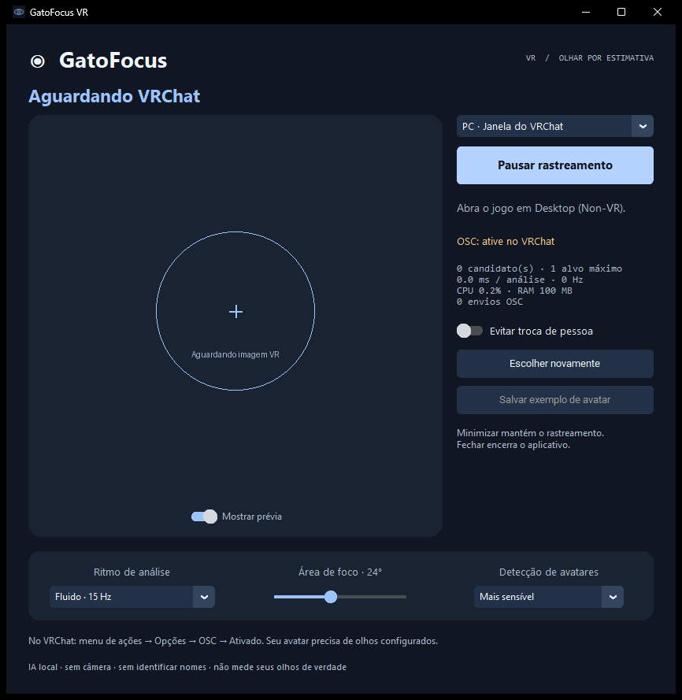

<p align="center"></p>

# Olhar por estimativa para VRChat

O **GatoFocus VR** analisa a imagem do jogo, escolhe um avatar próximo ao centro da visão e envia uma direção de olhar pelo OSC oficial do VRChat. Mantém **um alvo por vez**, acompanha seu movimento e exige um breve tempo de foco antes de trocar de pessoa.

**Versão inicial de testes para Windows 10/11 x64.** O detector reconhece pessoas; avatares muito estilizados, pequenos, parcialmente ocultos ou sem forma humana podem não ser reconhecidos. Não é medição dos seus olhos reais nem reconhecimento da identidade dos jogadores.



## Baixar e abrir

1. Baixe o ZIP nas [Releases](https://github.com/GABRIELMSORENSEN/GatoFocus-VR/releases).
2. Extraia a pasta inteira e abra **Iniciar GatoFocus.cmd** ou **GatoFocusVR.exe**.
3. No VRChat, ative **Menu de ações → Opções → OSC → Ativado**. O avatar precisa ter olhos/eye-look configurados.
4. Escolha a fonte e clique em **Iniciar rastreamento**.
5. Mantenha um avatar próximo ao centro por aproximadamente 0,65 segundo. O retângulo verde mostra o único alvo acompanhado.

O modelo já está incluído no ZIP. Não há conta, API paga nem download de modelo durante o uso.

## PC agora, Quest depois

| Fonte | Como usar | Janela pequena, coberta ou minimizada |
|---|---|---|
| **PC · Janela do VRChat** | VRChat em **Desktop (Non-VR)**. Captura pela API Windows Graphics Capture. | O GatoFocus pode ficar minimizado. A janela do jogo pode ficar pequena ou coberta, mas deve permanecer restaurada e renderizando. Se o jogo for minimizado ou parar de enviar quadros, o envio do olhar é suspenso. |
| **Quest · SteamVR** | Quest conectado ao PC pelo SteamVR; VRChat rodando em VR. Captura diretamente a textura do compositor. | O tamanho da janela espelhada do jogo não determina a captura. A implementação usa a textura do headset; a validação real com Quest ainda está pendente. |

O modo Quest requer **PCVR via SteamVR**. Não é um APK para o VRChat standalone do Quest. Não instala driver nem altera Standable, ALVR, Virtual Desktop, Steam Link ou as configurações do SteamVR.

No modo PC, a conversão para ângulos usa uma estimativa inicial de 60° de campo de visão vertical; mudar o FOV do jogo pode alterar a amplitude do olhar. Em VR, a projeção e a rotação do olho vêm do SteamVR. Não envia comandos de câmera, mouse, corpo ou mãos.

## Controles

- **Iniciar/Pausar:** inicia ou interrompe captura e envio. Fechar encerra o processo; minimizar mantém o trabalho.
- **Leve · 6 Hz:** padrão. Também há 10 e 15 análises por segundo. O olhar é suavizado e enviado em até 30 Hz quando há alvo e o VRChat está escutando OSC.
- **Área de foco:** limita a região em que uma nova pessoa pode ser escolhida.
- **Detecção:** mais sensível ajuda em avatares difíceis, mas pode aumentar falsos positivos.
- **Evitar troca de pessoa:** mantém o alvo atual enquanto ele continuar associado visualmente.
- **Escolher novamente:** solta o alvo e recomeça pelo centro.
- **Mostrar prévia:** pode ser desligado para reduzir trabalho da interface.

O rastreamento tolera uma oclusão breve e abandona o alvo após aproximadamente 0,85 segundo sem associação. Cruzamentos entre pessoas parecidas ainda podem causar trocas. Ao parar o envio, o VRChat volta ao comportamento automático após o timeout próprio de cerca de 10 segundos. Piscadas continuam sob controle do jogo.

## Exemplos de avatares para treinamento posterior

Entre pelo PC e use **Salvar exemplo de avatar** quando houver uma imagem. O editor congela aquele quadro: arraste retângulos em todos os avatares visíveis, remova erros com o botão direito e salve.

Os exemplos ficam somente em `%LOCALAPPDATA%\GatoFocusVR\examples`, como PNG + rótulos YOLO normalizados da classe `person`. Cada exemplo inclui metadados indicando que **o treinamento ainda não foi aplicado**. O botão não finge treinar o modelo: esta versão coleta/corrige dados; o ajuste dos pesos precisa de uma etapa posterior com conjunto de validação. O mesmo detector e esses exemplos podem servir ao modo PC e ao modo Quest, mas convém incluir imagens dos dois modos.

Não há gravação contínua nem envio automático dessas imagens ao GitHub ou à internet. Revise o conteúdo antes de compartilhar exemplos.

## Desempenho e validação

YOLOX-Nano ONNX: **3.659.407 bytes**, execução na CPU com duas threads, entrada 416 × 416. A captura SteamVR reduz a imagem na GPU antes da leitura pela CPU. Há um custo adicional; nenhum software de visão garante impacto zero no FPS.

Neste PC, o teste isolado de uma imagem com pessoas ficou em aproximadamente **10 ms por análise** (mediana, 20 execuções; não é medição de FPS do VRChat). O painel mostra o consumo do próprio processo e a latência de inferência. Detalhes e limites: [VALIDATION.md](docs/VALIDATION.md).

## Compilar

Python 3.11 x64 e Visual Studio Build Tools 2022 com C++/Windows SDK. O caminho padrão do compilador está em `scripts/build_native.cmd`; ajuste-o se necessário.

```powershell
python -m venv .venv
.\.venv\Scripts\python -m pip install -r requirements.txt
.\.venv\Scripts\python scripts/setup.py
.\scripts\build_native.cmd
.\.venv\Scripts\python main.py --start
```

Para validar e empacotar:

```powershell
.\.venv\Scripts\python -m unittest discover -s tests -v
.\.venv\Scripts\python -m pip install pyinstaller==6.22.3
.\.venv\Scripts\python scripts/build.py
```

O setup verifica hashes SHA-256 das dependências em `assets/dependencies.json`. A compilação gera um ZIP portátil em `release/`.

## Arquitetura e fontes

- `native/capture.cpp`: cliente OpenVR/D3D11 separado do jogo, textura do olho esquerdo e projeção.
- `gatofocus/capture.py`: captura SteamVR ou somente a janela do processo VRChat.
- `gatofocus/vision.py`: YOLOX, associação por geometria/aparência e seleção temporal do alvo.
- `gatofocus/engine.py`: análise limitada, supervisão de frames e envio suavizado.
- `gatofocus/osc.py`: somente `/tracking/eye/CenterPitchYaw` em `127.0.0.1:9000`.
- `gatofocus/ui.py` e `annotation_ui.py`: painel e exemplos locais.

Referências oficiais: [VRChat OSC Eye Tracking](https://docs.vrchat.com/docs/osc-eye-tracking), [Valve OpenVR](https://github.com/ValveSoftware/openvr), [YOLOX](https://github.com/Megvii-BaseDetection/YOLOX), [Windows Capture](https://github.com/NiiightmareXD/windows-capture).

## Privacidade e licença

Configurações, diagnóstico e exemplos ficam em `%LOCALAPPDATA%\GatoFocusVR`. A prévia não é salva automaticamente. A rede do app em execução é usada apenas para OSC local; o script de instalação baixa dependências públicas. Não lê memória do jogo, injeta código, instala mods nem identifica jogadores por nome.

Código próprio sob [MIT](LICENSE). Bibliotecas/modelos mantêm suas licenças: [THIRD_PARTY_NOTICES.md](THIRD_PARTY_NOTICES.md).
